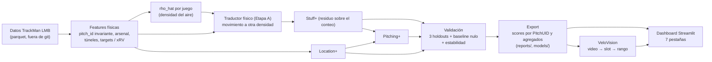

# Diablos AeroVision

**Calidad de pitcheo ajustada por la altitud de la Ciudad de México.**
Hackathon ISAC 2026 · Reto 2 · Diablos Rojos del México.

**App pública:** https://diablos-aerovision.streamlit.app

  

---

## 1. Qué es y por qué

**El problema.** El Estadio Alfredo Harp Helú está a unos 2,240 m. El aire es menos denso, y eso cambia a la vez dos cosas: el pitcheo se mueve distinto (Magnus y arrastre bajan, la gravedad no) y la pelota bateada vuela más. Un Stuff+ calculado "a nivel del mar" no le dice al cuerpo técnico cuánto vale un pitcheo en su propio parque.

**La propuesta.** AeroVision evalúa cada lanzamiento de la LMB con tres submodelos (**Stuff+**, **Location+**, **Pitching+**) y los reporta en dos sabores: *neutral* (densidad de nivel del mar) y *CDMX* (densidad mediana de la categoría `Extreme Altitude`). La diferencia es `ΔStuff+ CDMX = CDMX − neutral`. Escala: `100 + 10·z`, con la media y la desviación estándar del Stuff+ neutral de la LMB; más alto es mejor para el pitcher.

**Por qué una app y no solo un modelo.** El cuerpo técnico decide con casos concretos: "¿cuánto pierde este pitcheo en el Harp Helú?", "¿a quién fichamos?", "¿qué referencias reales sigue este prospecto?". Un modelo en un notebook no responde eso; una herramienta con simulador, ranking, referencias y entrada de video sí. Además, la app muestra la procedencia de cada cifra y sus límites.

### Las 7 pestañas

| Pestaña | Pregunta de negocio |
|---|---|
| **Inicio** | ¿Qué es AeroVision, qué cifras lo respaldan y a qué herramienta voy según mi pregunta? |
| **Simulador** | ¿Cuánto pierde (o gana) este pitcheo en el Harp Helú frente a nivel del mar? Entrada manual, presets y comparación lado a lado, con explicación SHAP aditiva. |
| **Mapa de movimiento** | ¿Qué formas de movimiento (IVB × HB) de la liga ganan o pierden Stuff+ en altitud? |
| **Leaderboard** | ¿Quién rinde mejor en CDMX? Ranking por pitcher y temporada con tarjeta de arsenal. |
| **Sculptor** | ¿Qué pares reales de la liga, con el mismo slot y velocidad, sostienen mejor su arsenal en CDMX? Son referencias factibles observadas, no una receta causal. |
| **VeloVision** | ¿Qué rango de arsenal corresponde a un prospecto sin TrackMan, a partir de un video de celular? Mide la mecánica del clip y entrega rangos, no un valor puntual. |
| **Modo anotación** | Herramienta interna para que dos personas marquen puntos del cuerpo en el frame de soltura y se mida el piloto de VeloVision. Se corre en local. |

---

## 2. Cifras clave (a la fecha, 22-oct-2026)

Todas se leen de `reports/` o de `models/` con el script de `analysis/` o con una lectura directa; ninguna está escrita a mano en el código de la app (la portada las calcula en vivo). Alcance: 634,624 pitcheos, 1,135 pitchers, temporadas 2024–2026 (`reports/leaderboards/pitcher_season_leaderboard.csv`).

**Densidad.** ρ̂ de CDMX = 0.852, es decir, ~15 % menos aire que a nivel del mar (`models/stuff_model.joblib`, atributo `rho_extreme_median_`; coincide con `rho_cdmx_used` de `pitcher_arsenal_breakdown.csv`). `Extreme Altitude` agrupa varios parques; "CDMX" es esa mediana.

**Validación en holdouts** (`reports/validation/holdout_metrics.csv`; reducción relativa del RMSE de `xrv_pitcher` frente al baseline nulo por conteo):

| Modelo | Pitcher (media de 5 folds) | Season (train 2024–25, test 2026) | Park (train No + Medium, test Extreme) |
|---|---:|---:|---:|
| Pitching+ | 4.50 % (4.31–4.71) | 4.77 % | 4.14 % |
| Location+ | 4.36 % (4.21–4.58) | 4.63 % | 4.00 % |
| Stuff+ | 0.02 % (−0.01–0.04) | 0.02 % | −0.00 % |

Lectura honesta: **Pitching+ y Location+ mejoran el baseline; Stuff+ empata con él en xRV.** Por eso Stuff+ se presenta como descriptor físico del pitcheo y no como predictor de xRV por pitcheo. Stuff+ se juzga en los targets de stuff (whiff, chase, contacto) y en `xrv_pitcher` con tolerancia de empate de 1e-4 (criterio de HACK-012, ver `docs/TASKS.md`).

**Estabilidad año a año** (`reports/validation/year_to_year_stability.csv`, 202 pitchers, **en muestra** 2024–25): r de Pearson = 0.741 para Stuff+, 0.608 para Location+ y 0.602 para Pitching+. Es en muestra; no es una estabilidad fuera de muestra.

**ΔStuff+ CDMX por familia** (`reports/leaderboards/pitcher_arsenal_breakdown.csv`, media ponderada por número de pitcheos):

| Familia | ΔStuff+ (puntos) | Pitcheos |
|---|---:|---:|
| Four-Seam | −4.52 | 230,278 |
| Sinker | −2.12 | 107,263 |
| Changeup | −1.60 | 85,861 |
| Splitter | −1.26 | 4,955 |
| Curveball | −0.46 | 50,045 |
| Cutter | −0.39 | 17,888 |
| Slider | −0.30 | 138,334 |

**Descomposición del efecto total** (`reports/altitude/channel_decomposition.csv`, diferencia intra-pitcher de `xrv_pitcher`, 778 pitchers; unidades de carrera por pitcheo):

| Término | Estimado | Parte del total |
|---|---:|---:|
| Total | −0.0141 | 100 % |
| Canal Stuff (el pitcheo se mueve menos) | −0.0013 | 9.0 % |
| Canal parque (la bola bateada vuela más) | −0.0060 | 42.5 % |
| Residuo no atribuido | −0.0069 | 48.5 % |

El residuo no se asigna a ningún canal y se muestra con su propia etiqueta. Los intervalos están en el CSV.

**Piloto de VeloVision** (`reports/validation/vision_validation_summary.csv`): **n = 4 lanzamientos** anotados por 2 personas, **sin revisión independiente** (decisión del usuario, ver `docs/TASKS.md`). ICC del slot entre anotadores = 0.997. MAE del slot de la visión contra el promedio humano = 12.2° con el frame anotado (n = 3) y 6.4° con el frame detectado (n = 4). Error del frame de release ≈ 177 ms. Error combinado recomendado para la ventana de búsqueda = ±14.7° (n = 3). Con n = 4 son cifras de un piloto, no una medida de precisión.

---

## 3. Arquitectura



Notas de diseño:
- **Stuff+** se entrena como residuo sobre el baseline por conteo; el conteo entra solo como *offset*, nunca como feature. Sin proxies de ubicación (`VertRelAngle`, `HorzRelAngle_norm`, túneles a 170 ms), regularizado con CV por pitcher solo en `No Altitude` ≤ 2025.
- **Location+ y Pitching+** sí usan ubicación y conteo.
- **No se usa `AutoPitchType`** para comparar altitudes: TrackMan reetiqueta según el aire. Se usa `pitch_id`, invariante.

---

## 4. Estructura del repositorio

```
dashboard/         Streamlit: app.py + una pestaña por módulo, tema y componentes
src/               librería: features/, physics/ (rho_hat), models/ (Stuff+, Location+/Pitching+, traductor),
                   vision/ (VeloVision), sculptor/ (Pitch Sculptor), targets, splits, baseline, io, config
analysis/          corridas pesadas → reports/ (validación, hipótesis, diagnóstico, export, visión, cifras del paper)
reports/           tablas agregadas (sí van a git; nunca pitch-by-pitch)
models/            *.joblib versionados + pose_landmarker_full.task (MediaPipe)
tests/             pytest (fixture sintético, sin datos reales)
docs/              contrato, plan, tablero de tareas, despliegue, diseño, benchmark
docs/latex/        documento técnico y perfil/recomendaciones (LaTeX)
data/              NO va a git: parquet y clips de video
```

---

## 5. Correr en local

```powershell
python -m venv .venv
.venv\Scripts\activate
pip install -r requirements.txt
streamlit run dashboard/app.py
```

Para análisis y tests: `pip install -r requirements-dev.txt` (incluye `requirements.txt`).

- **La app no necesita el parquet.** Lee `models/*.joblib` y `reports/**/*.csv`, que ya están versionados. El modelo de pose `models/pose_landmarker_full.task` también.
- **El parquet no se incluye.** Los scripts de `analysis/` esperan `data/stuff_processed_df.parquet` (se genera desde el parquet crudo con el pipeline del paso 1; el crudo va en `data/stuff_model_df.parquet` o en la ruta que resuelva `src/config.py`) y el diccionario `data/stuff_plus_data_dictionary.csv`. Requiere `pyarrow >= 20`.
- **Clips de video** de VeloVision y del Modo anotación: carpeta local `data/vision_clips/` (no versionada, `*.mp4`/`*.mov` están en `.gitignore`). La app pública acepta un video subido por el usuario.
- Python 3.12 (con 3.11 o superior debería funcionar; lo probado es 3.12.1).

## 6. Tests

```powershell
.venv\Scripts\python.exe -m pytest -q
```

Los tests corren con un fixture sintético (1,200 filas con las 84 columnas del diccionario); no necesitan el parquet. Una corrida completa tarda unos minutos.

## 7. Regenerar los reportes

Desde la raíz, con el parquet en `data/`, en este orden:

```powershell
python -m src.pipeline_step1                       # parquet crudo → data/stuff_processed_df.parquet + reports/altitude/ base
python -m analysis.run_validation                  # holdouts, estabilidad → reports/validation/
python -m analysis.run_hypotheses --input data/stuff_processed_df.parquet --output-dir reports/altitude   # H1–H4 y canales
python -m analysis.stuff_diagnostics               # diagnóstico de Stuff+ → reports/validation/stuff_diagnostics.csv
python -m analysis.export_scores                   # scores por PitchUID (data/deliverables/), agregados y models/*.joblib
python -m analysis.validate_vision                 # piloto de VeloVision (necesita anotaciones y clips locales)
python -m analysis.build_paper_numbers             # cifras y tablas LaTeX en docs/latex/generated/
```

Las corridas de validación y de hipótesis son pesadas (minutos a horas según el equipo). Ver `--help` de cada script para sus opciones (`--resume`, `--seed`, `--bootstrap`).

## 8. Compilar el paper

Las instrucciones están en [docs/latex/README.md](docs/latex/README.md): `pdflatex` dos veces sobre `documento_tecnico.tex` y `perfil_recomendaciones.tex`, o subir `docs/latex/` a Overleaf. Las cifras salen de `docs/latex/generated/`; no se editan a mano.

## 9. Despliegue

Streamlit Community Cloud desde `main`, Python 3.12, `packages.txt` con las librerías de sistema que pide MediaPipe. Pasos, requisitos y estado de la prueba de humo en [docs/DEPLOY.md](docs/DEPLOY.md).

---

## 10. Honestidad y limitaciones

- **Sin SSW medible.** El dataset no trae orientación de costura. El efecto Seam-Shifted Wake no se puede ajustar ni medir; cualquier guía de agarre es coaching cualitativo, etiquetada como tal, no salida del modelo. (El SSW, como Magnus y arrastre, también se debilita con el aire.)
- **`Extreme Altitude` agrupa parques.** "CDMX" en la app es la mediana de esa categoría (ρ̂ = 0.852), no un estadio medido por separado.
- **Stuff+ es un descriptor, no un predictor.** Empata con el baseline en xRV por pitcheo (tabla de la sección 2).
- **La estabilidad es en muestra** (2024–25, 202 pitchers).
- **VeloVision entrega rangos, no valores.** Un video monocular no mide spin, eje, IVB/HB ni velocidad precisa. El piloto tiene **n = 4**, dos anotadores y **no pasó por una auditoría independiente**; con tan pocos casos y estas diferencias entre frame anotado y detectado, no se afirma precisión.
- **El error frente a TrackMan no se mide.** Ambos anotadores comparten el sesgo de origen del video, así que el MAE contra humanos no lo detecta. El CSV lo marca como "no medido".
- **2026 está fuera de muestra** en el holdout de temporada (entrenamiento 2024–25, prueba 2026); la estabilidad año a año solo cubre 2024–25.
- **Sculptor y las referencias son observacionales**: pares reales de la liga, sin afirmación causal.
- **No se empareja un video con un pitcher del dataset**: `pitcher_anon_id` es anónimo.
- El residuo de la descomposición (48.5 %) no se atribuye a ningún canal.

## 11. Documentación

| Documento | Contenido |
|---|---|
| [AGENTS.md](AGENTS.md) | Reglas obligatorias y protocolo por rol |
| [PROJECT_CONTEXT.md](PROJECT_CONTEXT.md) | Idea, física, métodos, entregables |
| [docs/TASKS.md](docs/TASKS.md) | Tablero y especificación de HACK-001 a HACK-021, con revisiones |
| [docs/CONTRACT.md](docs/CONTRACT.md) | Contrato de columnas y firmas |
| [docs/PLAN.md](docs/PLAN.md) | Plan, olas y flujo Orquestador → Worker → Revisor |
| [docs/DEPLOY.md](docs/DEPLOY.md) | Despliegue público |
| [docs/PLAN_REDISENO_UI.md](docs/PLAN_REDISENO_UI.md), [docs/DISENO_UI_NIELSEN.md](docs/DISENO_UI_NIELSEN.md) | Diseño visual y usabilidad |
| [docs/COMPETENCIA.md](docs/COMPETENCIA.md) | Benchmark del rival y nuestra respuesta |
| [docs/CONTINUAR_EN_OTRA_PC.md](docs/CONTINUAR_EN_OTRA_PC.md) | Setup en otra máquina |
| [docs/latex/README.md](docs/latex/README.md) | Entregables escritos en LaTeX |

## 12. Créditos

Proyecto del equipo para el **Hackathon ISAC 2026**, **Reto 2 · Diablos Rojos del México** (*Stuff Plus Model: calidad de pitcheo ajustada por entorno*). Datos TrackMan de la LMB proporcionados por los organizadores; no se redistribuyen. VeloVision usa MediaPipe Pose Landmarker.
