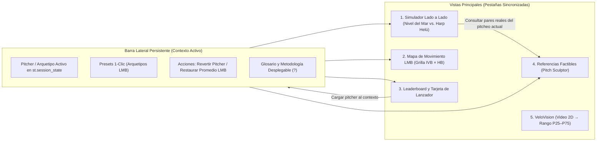
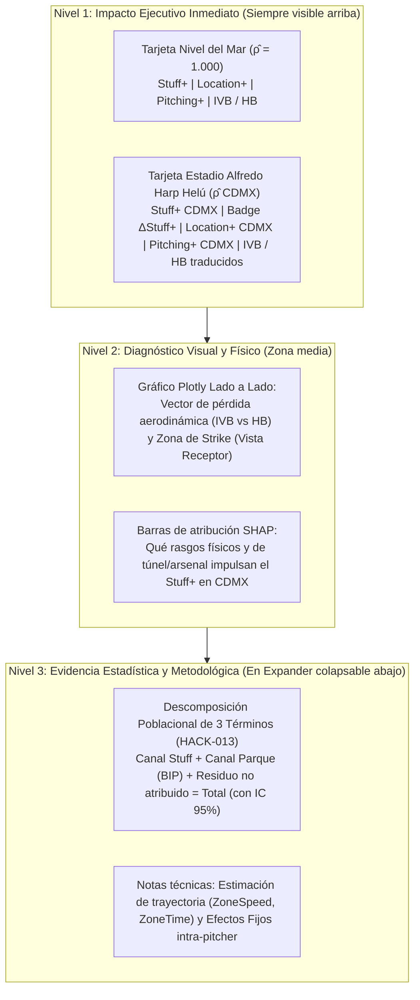

# Especificación de Diseño UX/UI Basada en las 10 Heurísticas de Jakob Nielsen — Diablos AeroVision

> **Nota de estado (22-oct-2026): documento de especificación de usabilidad; la implementación visual vigente es [`PLAN_REDISENO_UI.md`](PLAN_REDISENO_UI.md) (HACK-019).**
> Qué se implementó: barra de contexto, presupuesto de latencia, textos de honestidad, divulgación progresiva y flujo guiado. Qué cambió:
> - **Modo claro.** Las referencias de este documento a fondos oscuros, colores y tamaños concretos (p. ej. `#8A8A8A`) son del diseño inicial; los tokens vigentes están en `dashboard/theme.py` y `.streamlit/config.toml`.
> - **Pestañas.** Hoy son **7** (Inicio, Simulador, Mapa de movimiento, Leaderboard, Sculptor, VeloVision, Modo anotación), no 5.
> - **ρ̂ de CDMX.** Donde este documento dice ρ̂ ≈ 0.78, **el valor correcto es el del modelo: 0.852** (`models/stuff_model.joblib`, `rho_extreme_median_`), mediana de `Extreme Altitude`. El 0.78 es el valor teórico de atmósfera estándar a 2,240 m; la app lee siempre el del modelo y nunca lo escribe a mano.
> - Las cifras de la descomposición se leen de `reports/altitude/channel_decomposition.csv`.

> **Proyecto:** Hackathon ISAC 2026 · Reto 2 Diablos Rojos del México  
> **Producto:** **Diablos AeroVision** (`dashboard/app.py`, `dashboard/ui_utils.py`, `dashboard/sculptor_tab.py`, `dashboard/velovision_tab.py`)  
> **Usuarios objetivo:** Pitching Coach, Coordinador de Bullpen, Analista de Scouting y Dirección Deportiva de Diablos Rojos del México.  
> **Idioma de la interfaz:** 100 % Español (con siglas técnicas estándar de laboratorio entre paréntesis).

---

## 1. Resumen Ejecutivo y Arquitectura de Navegación

El diseño de **Diablos AeroVision** traduce modelos físicos y estadísticos complejos ($\hat{\rho}$, `Stuff+`, `Location+`, `Pitching+`, descomposición mediacional de 3 términos, búsqueda de referencias biomecánicas e inferencia por visión artificial) en una herramienta de toma de decisiones rápida para el cuerpo técnico.

Para cumplir con las decisiones de arquitectura y usabilidad, la aplicación se organiza bajo un **flujo guiado en 5 pestañas sincronizadas con barra lateral persistente de contexto** y **divulgación progresiva (*Progressive Disclosure*)**:

---

## 2. Aplicación de las 10 Heurísticas de Usabilidad de Jakob Nielsen

### Heurística #1: Visibilidad del Estado del Sistema (*Visibility of System Status*)
El usuario debe saber en todo momento qué pitcher o pitcheo está evaluando, bajo qué densidad relativa del aire ($\hat{\rho}$) se calculan las métricas y si una predicción proviene de una medición directa, una simulación física o una estimación condicionada.

- **Barra lateral persistente de contexto:** Muestra en todo momento una tarjeta fija con el **Pitcheo Activo en Memoria**:
  - Origen del estado: badge indicador `🟢 Preset LMB`, `🔵 Pitcher Real: [pitcher_anon_id]` o `🟡 Editado Manualmente`.
  - Resumen compacto: `pitch_id`, mano del lanzador (`R`/`L`), `RelSpeed (mph)`, `SpinRate (rpm)`, `arm_slot_deg (°)` e `IVB / HB (in)` a nivel del mar.
- **Indicadores explícitos de entorno aerodinámico ($\hat{\rho}$):**
  - En la tarjeta izquierda se etiqueta explícitamente **Nivel del Mar ($\hat{\rho} = 1.000$ · Entorno Neutral)**.
  - En la tarjeta derecha se etiqueta **Altitud Extrema / Estadio Alfredo Harp Helú ($\hat{\rho}_{\text{CDMX}} \approx 0.78$)**, aclarando mediante nota visible que la categoría `Extreme Altitude` del dataset agrupa parques de gran altitud de la LMB.
- **Feedback de rendimiento y presupuesto de latencia:**
  - Los modelos (`models/*.joblib`) y tablas agregadas (`reports/**/*.csv`) se precargan con `@st.cache_resource` y `@st.cache_data` mostrando spinners con mensajes específicos de etapa (`"Cargando modelos físicos y de Stuff+..."`, `"Calculando atribución SHAP del pitcheo activo..."`).
  - **SLA de respuesta en UI:** Carga inicial en frío $< 20\text{ s}$; recálculo interactivo en caliente $< 3\text{ s}$ tras mover cualquier control.

---

### Heurística #2: Relación entre el Sistema y el Mundo Real (*Match Between System and the Real World*)
La aplicación habla el lenguaje del dugout y del laboratorio de pitcheo en español, evitando exponer nombres crudos de variables sin contexto.

- **Diccionario de interfaz para cuerpo técnico (Español + sigla técnica):**
  | Variable interna (`CONTRACT.md`) | Etiqueta en la Interfaz (UI) | Unidad / Convención de Signo |
  | :--- | :--- | :--- |
  | `pitch_id` | Familia de Pitcheo (Invariante a la altitud) | Ej. `Four-Seam (Recta 4 costuras)` |
  | `RelSpeed` | Velocidad de salida (`RelSpeed`) | `mph` (1 decimal) |
  | `SpinRate` | Tasa de giro (`SpinRate`) | `rpm` (entero) |
  | `SpinAxis` | Eje de giro (`SpinAxis`) | `grados (°)` + equivalente en reloj (`HH:MM`) |
  | `InducedVertBreak` | Quiebre vertical inducido (`IVB`) | `pulgadas (in)` ($+$ resistencia a caer / *ride*) |
  | `HorzBreak_norm` | Quiebre horizontal normalizado (`HB`) | `pulgadas (in)` ($+$ hacia lado del brazo / *run*, $-$ hacia lado del guante / *cut-sweep*) |
  | `RelHeight` / `RelSide` / `Extension` | Punto de soltura (Altura, Lado, Extensión) | `pies (ft)` (2 decimales) |
  | `arm_slot_deg` | Ángulo de brazo (`Arm Slot`) | `grados (°)` sobre la horizontal |
  | `velo_diff_vs_fb` | Diferencial de velocidad vs. recta primaria | `mph` (1 decimal) |
- **Metáforas físicas visuales y convención de perspectiva:**
  - En el plano de movimiento (Vista 1 y Vista 2), la pérdida aerodinámica entre Nivel del Mar y CDMX se dibuja como un **vector de caída de movimiento** (flecha desde $(HB_{\text{mar}}, IVB_{\text{mar}})$ hacia $(HB_{\text{CDMX}}, IVB_{\text{CDMX}})$), reflejando que las fuerzas Magnus, arrastre y *Seam-Shifted Wake* (SSW) escalan con $\rho \cdot v^2$, mientras la gravedad permanece constante.
  - El gráfico de ubicación en el plato (`PlateLocSide` $\times$ `PlateLocHeight`) indica explícitamente **"Perspectiva del Receptor (Catcher's View)"** con el home plate dibujado en la base para evitar confusiones entre esquina interna y externa.

---

### Heurística #3: Control y Libertad del Usuario (*User Control and Freedom*)
El coach puede explorar escenarios contrafactuales libremente y regresar a un estado conocido en un solo clic sin perder su punto de comparación.

- **Doble acción de restauración no destructiva:**
  1. **Botón `"Revertir a valores originales del pitcher"`:** Disponible cuando el usuario ha cargado un `pitcher_anon_id` real del catálogo y modificó algún slider manualmente. Restaura el snapshot exacto del lanzador sin recargar la página.
  2. **Botón `"Restaurar a promedio LMB"`:** Ubicado en la barra lateral y en el encabezado del simulador; restablece todos los controles a la mediana de la liga para la familia de pitcheo (`pitch_id`) activa.
- **Transferencia de contexto en 1 clic entre pestañas:**
  - Desde **Vista 3 (Leaderboard)**: botón `"Llevar pitcheo al Simulador / Sculptor"` que carga el `pitcher_anon_id` y su `pitch_id` seleccionado en `st.session_state`.
  - Desde **Vista 1 (Simulador)**: botón `"Buscar pares biomecánicos para este pitcheo"` que sincroniza los parámetros actuales con la **Vista 4 (Pitch Sculptor)** sin obligar al usuario a transcribir datos.

---

### Heurística #4: Consistencia y Estándares (*Consistency and Standards*)
Dado que el color institucional de los Diablos Rojos del México es el **Rojo Escarlata (`#CE1126`)**, el sistema separa rigurosamente el **color de identidad de marca** del **color semántico de desempeño/alerta**, e incorpora iconos redundantes para garantizar accesibilidad a usuarios con daltonismo (WCAG 1.4.1).

- **Escala estandarizada `Score+ = 100 + 10·z`:**
  - En toda la aplicación (`Stuff+`, `Location+`, `Pitching+`), `100` representa siempre el promedio de la LMB evaluado en entorno neutral ($\hat{\rho} = 1.00$), y cada `10` puntos equivale a 1 desviación estándar ($+$ = mejor para el lanzador).
- **Semáforo divergente centrado en 100 con redundancia simbólica:**
  | Rango de `Score+` | Rango de $\Delta\text{Stuff+}_{\text{CDMX}}$ | Color Semántico | Prefijo / Badge | Significado para el Coach |
  | :---: | :---: | :--- | :---: | :--- |
  | **$\ge 110$** | **$\ge +1.0$** | Verde Esmeralda (`#3FB950`) | `▲ ÉLITE` | **Élite / Gana valor relativo en altitud** |
  | **$102 \text{ a } 109$** | **$+0.2 \text{ a } +0.9$** | Azul Claro (`#58A6FF`) | `↗ SOBRE PROM.` | **Por encima del promedio LMB / Resiliente** |
  | **$95 \text{ a } 101$** | **$-0.3 \text{ a } +0.1$** | Gris Neutro (`#C9D1D9`) | `● PROMEDIO` | **Promedio LMB ($100$) / Neutro** |
  | **$88 \text{ a } 94$** | **$-1.0 \text{ a } -0.4$** | Ámbar Alerta (`#D29922`) | `↘ ALERTA` | **Debajo del promedio / Pérdida moderada** |
  | **$< 88$** | **$< -1.0$** | Coral Crítico (`#F85149`) | `▼ CRÍTICO` | **Riesgo alto / Fuerte castigo aerodinámico** |

  > [!IMPORTANT]
  > El **Rojo Escarlata Diablos (`#CE1126`)** se reserva exclusivamente para **bordes superiores de marca, encabezados institucionales, pestañas activas y selectores primarios**, nunca como indicador de error ni como celda negativa en tablas.

---

### Heurística #5: Prevención de Errores (*Error Prevention*)
El sistema impide entradas físicamente imposibles, explicita la separación de variables para evitar *data leakage* y bloquea inferencias científicamente inválidas antes de que ocurran.

- **Límites físicos duros en controles de entrada (`HACK-002`):**
  - `RelSpeed`: acotado estrictamente a `[65.0, 105.0] mph`.
  - `SpinRate`: acotado estrictamente a `[500, 3600] rpm`.
  - `SpinAxis`: acotado a `[0°, 360°]`.
  - `arm_slot_deg`: acotado a `[0°, 90°]`.
- **Separación visual anti-leakage en el Simulador:**
  - Los controles de contexto situacional (`Balls`, `Strikes`, `Outs`, `BatterSide`, `PlateLocSide`, `PlateLocHeight`) están agrupados en un contenedor rotulado:
    > *"🎯 Variables exclusivas de Location+ y Pitching+ (No alteran Stuff+ por diseño libre de leakage)"*.
- **Advertencias en tiempo real para combinaciones biomecánicamente atípicas:**
  - Si el usuario configura una combinación fisiológicamente improbable (ej. `SpinRate > 3200 rpm` con `RelSpeed < 80 mph`, o un `Four-Seam` con `InducedVertBreak < 0 in`), se muestra un banner preventivo en ámbar (`#D29922`):
    > *"⚠️ Combinación física atípica en la LMB: estás evaluando una extrapolación fuera del soporte habitual de lanzadores reales."*
- **Bloqueo duro contra extrapolación en *Pitch Sculptor* (`HACK-016`):**
  - El buscador aplica filtros estrictos de factibilidad (`misma mano`, `arm_slot_deg ± 6.0°`, `RelHeight ± 0.35 ft`, `fb_velo ± 2.0 mph`, `n_pitches >= 50`).
  - Si existen **menos de 5 lanzadores pares (`n_peers < 5`)**, el sistema **jamás relaja los filtros en silencio** ni inventa un pitcheo sintético: oculta las tarjetas de ganancia y despliega el estado estructurado `INSUFFICIENT_PEERS`.

---

### Heurística #6: Reconocimiento Antes que Recuerdo (*Recognition Rather Than Recall*)
Un pitching coach no necesita recordar de memoria las coordenadas de soltura o tasas de giro típicas de cada pitcheo para evaluar hipótesis físicas.

- **Presets rápidos de arquetipos LMB en 1 clic:**
  Disponibles tanto en la barra lateral como en la cabecera de la Vista 1, calculados sobre percentiles reales del catálogo LMB:
  1. **`🔥 Recta Alta IVB (Arquetipo Nivel del Mar)`:** Muestra cómo un pitcheo dependiente de fuerza Magnus vertical pierde quiebre inducido al subir a CDMX (Hipótesis H1).
  2. **`🌀 Sweeper / Slider de Giro Alto`:** Muestra la sensibilidad del quiebre horizontal en aire menos denso.
  3. **`🪨 Splitter / Cambio Resiliente`:** Muestra un pitcheo basado en gravedad y diferencial de velocidad con la recta primaria (`velo_diff_vs_fb`) que preserva mejor su `Stuff+` en altitud (Hipótesis H2).
- **Selector de Pitcher Real con autocompletado:** Permite buscar por `(pitcher_anon_id, year, pitch_id)` mostrando entre paréntesis el volumen de pitcheos (`n_pitches`) y su velocidad media para identificar rápidamente el perfil.
- **Marcador persistente en el Mapa de Movimiento (Vista 2):** Al abrir la pestaña del Mapa de Movimiento LMB, el pitcheo activo en `st.session_state` se dibuja automáticamente sobre la grilla `(HorzBreak_norm, InducedVertBreak)` con dos marcadores conectados: `○ Nivel del Mar` $\to$ `★ CDMX (Harp Helú)`.

---

### Heurística #7: Flexibilidad y Eficiencia de Uso (*Flexibility and Efficiency of Use*)
La interfaz atiende tanto la presentación ejecutiva de 10 minutos ante Dirección Deportiva como la auditoría técnica detallada de intervalos de confianza.

- **Doble velocidad de interacción en controles:**
  - En el Simulador: carga instantánea por *Preset* o *Pitcher Real* (1 clic) + ajuste fino mediante sliders sincronizados con campos numéricos paso a paso (`step=0.1 mph`, `step=25 rpm`).
  - En el Leaderboard (Vista 3): filtros rápidos por temporada (`2024`, `2025`, `2026 out-of-sample`), rol (`Abridor / Opener` vs. `Relevista`), mano (`Derecho` / `Izquierdo`), umbral mínimo de pitcheos (`min_pitches`) y ordenamiento directo por `Stuff+ CDMX`, `ΔStuff+ CDMX` o `Pitching+ CDMX`.
- **Cálculo SHAP bajo demanda:** Para mantener cambios de slider por debajo de $1\text{ s}$, la inferencia del modelo físico y de `Stuff+` es instantánea, mientras que el gráfico de cascada/barras SHAP incluye un toggle `"Actualizar atribución SHAP en vivo"` (activo por defecto en presets, pausable durante barridos rápidos de sliders).

---

### Heurística #8: Diseño Estético y Minimalista (*Aesthetic and Minimalist Design*)
Se evita la saturación cognitiva mediante **Divulgación Progresiva (*Progressive Disclosure*)** organizada en tres niveles jerárquicos claros dentro de la Vista 1 (Simulador):

- **Regla de densidad visual y formato numérico:**
  - Ningún gráfico incluye rejillas secundarias innecesarias ni leyendas duplicadas.
  - Los KPIs en tarjetas usan **1 decimal** para scores (`104.2`), velocidades (`93.5 mph`) y quiebres (`16.4 in`), y **enteros** para giro (`2350 rpm`).
  - Las métricas científicas en unidades de carreras esperadas (`xRV` con 5 decimales e intervalos bootstrap al 95 %) se reservan para las tablas de evidencia estadística (Nivel 3).

---

### Heurística #9: Ayudar a los Usuarios a Reconocer, Diagnosticar y Recuperarse de Errores (*Help Users Recognize, Diagnose, and Recover from Errors*)
Cuando los datos o la física imponen una limitación, la interfaz explica **qué ocurrió**, **por qué ocurrió** y **qué acción concreta puede tomar el usuario**.

- **Caso 1: `INSUFFICIENT_PEERS` en Pitch Sculptor (`HACK-016`):**
  - *Diagnóstico explícito:* `"⚠️ INSUFFICIENT_PEERS: Se encontraron solo N lanzadores reales en la LMB con la misma mano, arm_slot_deg ± 6.0°, RelHeight ± 0.35 ft, fb_velo ± 2.0 mph y ≥ 50 pitcheos (mínimo requerido: 5 pares)."*
  - *Recuperación guiada en UI:* Muestra qué parámetro del pitcheo actual se encuentra en un percentil extremo de la liga (ej. `RelHeight = 6.95 ft, P99`) y ofrece un botón para centrar el filtro en el arquetipo más cercano o ajustar `min_pitches` dentro de los márgenes permitidos, sin relajar jamás las tolerancias biomecánicas en silencio.
- **Caso 2: Incertidumbre inherente a video monocular 2D en VeloVision (`HACK-017`):**
  - *Diagnóstico explícito:* Un video 2D permite estimar `arm_slot_deg`, altura de liberación y extensión relativa, pero **no observa `SpinRate`, `SpinAxis` ni quiebres `IVB/HB`**.
  - *Recuperación guiada en UI:* Reporta siempre el **rango intercuartílico honesto (`P25–P75`, mediana `P50` y banda `P10–P90`)** de `Stuff+ CDMX` condicionado al ángulo de brazo, y destaca el control **`Ingresar velocidad de radar de bolsillo (observed_velo_mph)`** mostrando cuánto se estrecha la incertidumbre (`IQR = P75 - P25`) al condicionar también por velocidad.

---

### Heurística #10: Ayuda y Documentación (*Help and Documentation*)
La ayuda es contextual, breve y está integrada exactamente donde se toman las decisiones, garantizando transparencia científica absoluta (`AGENTS.md` §2).

- **Glosario Rápido Desplegable en la Barra Lateral (`st.sidebar.expander("📘 Glosario y Metodología")`):**
  1. **¿Qué miden `Stuff+`, `Location+` y `Pitching+`?** Explicación concisa de los tres modelos y por qué `Stuff+` evalúa exclusivamente la física del lanzamiento y su relación con la recta primaria (cero *leakage* de conteo o ubicación).
  2. **¿Por qué la descomposición de altitud tiene exactamente 3 términos (`HACK-013`)?**
     Explicación transparente con las cifras reales estimadas sobre 778 pitchers pareados (`reports/altitude/channel_decomposition.csv`):
     - **Total observado ($\Delta\text{xRV}_{\text{total}} = -0.01413\text{ xRV/pitcheo}$):** Diferencia intra-pitcher entre `Extreme Altitude` y `No Altitude`.
     - **Canal Stuff ($-0.00034\text{ xRV}$, $2.4\%$ del total):** Cambio en valor atribuible exclusivamente a la pérdida física de movimiento $(\Delta\text{IVB}, \Delta\text{HB})$ predicha por el traductor físico.
     - **Canal Parque en bolas en juego — BIP ($-0.00600\text{ xRV}$, $42.5\%$ del total):** Contraste descriptivo en pelotas bateadas para misma velocidad y ángulo de salida.
     - **Residuo no atribuido ($-0.00779\text{ xRV}$, $55.1\%$ del total):** Etiquetado textualmente como `"residuo_no_atribuido (no se atribuye a ningún canal)"`. **Nunca** se suma ni se disfraza como Canal Parque.
  3. **¿Por qué usamos `pitch_id` en lugar de `AutoPitchType`?** Porque TrackMan reetiqueta pitcheos cuando pierden movimiento en altitud; `pitch_id` agrupa el repertorio con variables invariantes a la densidad del aire.
- **Badges obligatorios de honestidad científica in-situ:**
  - En **Vista 1 (Descomposición):** Nota fija aclarando que la descomposición de 3 términos es una **estimación poblacional de la liga**, no una partición causal del pitcheo individual simulado.
  - En **Vista 4 (Pitch Sculptor):**
    - `delta_gain_cdmx` lleva siempre el subtítulo: *"Diferencia observada frente a pares reales; no es una ganancia causal garantizada"*.
    - El bloque de agarre/mecánica se renderiza en un contenedor visualmente separado con el badge exacto:  
      `[Guía cualitativa de coaching — literatura biomecánica, no estimada del dataset]`.
  - En **Vista 5 (VeloVision):** Badge permanente indicando que los resultados son **rangos condicionados (`P10–P90` / `P25–P75`)** y que el video nunca se empareja con un `pitcher_anon_id` anónimo del dataset.

---

## 3. Sistema de Diseño, Tokens Visuales y Estado en Memoria

### 3.1 Paleta de Colores (`dashboard/ui_utils.py` y CSS)
| Token CSS / Constante Python | Hex | Uso en la Interfaz | Contraste sobre `#0D0D0D` / `#1A1A1A` |
| :--- | :---: | :--- | :---: |
| `--dr-bg-primary` (`BLACK`) | `#0D0D0D` | Fondo general de la aplicación (Negro Carbón) | Base |
| `--dr-bg-panel` (`PANEL`) | `#1A1A1A` | Fondo de tarjetas KPI, contenedores y expanders | Superficie elevada |
| `--dr-brand-red` (`RED`) | `#CE1126` | **Identidad Diablos Rojos**: borde superior de tarjeta CDMX, acento lateral de títulos, pestaña activa | 5.6:1 (AA) |
| `--dr-text-light` (`LIGHT`) | `#F5F5F5` | Texto primario, títulos y valores numéricos de Nivel del Mar | 18.1:1 (AAA) |
| `--dr-text-muted` (`GREY`) | `#8A8A8A` | Subtítulos en mayúsculas, unidades (`mph`, `rpm`, `in`) y notas al pie | 5.8:1 (AA) |
| `--dr-sem-elite` (`GREEN`) | `#3FB950` | Semáforo positivo (`▲ ÉLITE`: `Score+ >= 110` o $\Delta\text{Stuff+} \ge +1.0$) | 8.1:1 (AAA) |
| `--dr-sem-good` (`BLUE`) | `#58A6FF` | Semáforo sobre promedio (`↗ SOBRE PROM.`: `Score+ 102–109`) | 7.9:1 (AAA) |
| `--dr-sem-neutral` (`NEUTRAL`) | `#C9D1D9` | Semáforo neutro (`● PROMEDIO`: `Score+ 95–101`) | 11.4:1 (AAA) |
| `--dr-sem-warn` (`AMBER`) | `#D29922` | Advertencia física / `INSUFFICIENT_PEERS` / `Score+ 88–94` (`↘ ALERTA`) | 7.4:1 (AAA) |
| `--dr-sem-loss` (`CORAL`) | `#F85149` | Pérdida aerodinámica severa (`▼ CRÍTICO`: `Score+ < 88` o $\Delta\text{Stuff+} < -1.0$) | 6.2:1 (AA) |

### 3.2 Tipografía y Jerarquía de Tarjetas
- **Títulos de Sección (`.dr-title`):** `border-left: 8px solid #CE1126`, `padding-left: 14px`, `font-weight: 700`.
- **Número Principal KPI (`.dr-big`):** `font-size: 2.6rem`, `font-weight: 800`, `line-height: 1.1`, números tabulares (`font-variant-numeric: tabular-nums`) para evitar saltos horizontales al mover sliders.
- **Métricas Secundarias (`.dr-val`):** `font-size: 1.3rem`, `font-weight: 700`, `font-variant-numeric: tabular-nums` para `Location+`, `Pitching+`, `IVB (in)` y `HB (in)`.
- **Etiquetas de Campo (`.dr-lbl`):** `font-size: 0.78rem`, `text-transform: uppercase`, `letter-spacing: 0.05em`, color `#8A8A8A`.

### 3.3 Contrato de Estado en Memoria (`st.session_state`)
Para garantizar consistencia entre la Barra Lateral y las 5 pestañas sin perder referencias al editar controles, `dashboard/app.py` mantiene las siguientes claves canónicas en `st.session_state`:

| Clave en `st.session_state` | Tipo | Descripción y Comportamiento |
| :--- | :---: | :--- |
| `active_pitch_params` | `dict` | Diccionario con los parámetros físicos y de contexto actuales (`pitch_id`, `PitcherThrows`, `RelSpeed`, `SpinRate`, `SpinAxis`, `InducedVertBreak`, `HorzBreak_norm`, `RelHeight`, `RelSide`, `Extension`, `arm_slot_deg`, `fb_velo`, `PlateLocSide`, `PlateLocHeight`, `Balls`, `Strikes`, `Outs`, `BatterSide`). |
| `source_mode` | `str` | Enumeración: `"PRESET"`, `"REAL_PITCHER"`, o `"MANUAL_EDIT"`. Cambia automáticamente a `"MANUAL_EDIT"` cuando el usuario altera cualquier slider respecto al snapshot cargado. |
| `loaded_pitcher_snapshot` | `dict \| None` | Copia inmutable de los parámetros originales del último `(pitcher_anon_id, year, pitch_id)` cargado desde el selector o el Leaderboard; habilita el botón `"Revertir a valores originales del pitcher"`. |
| `last_sim_results` | `dict` | Resultados precalculados del pitcheo activo (`stuff_sea`, `stuff_cdmx`, `delta_stuff`, `ivb_cdmx`, `hb_cdmx`) para superponer el marcador `○ → ★` en el Mapa de Movimiento (Vista 2) sin recalcular modelos. |

---

## 4. Estructura Detallada por Vista (Wireframes Funcionales)

### Vista 1: Simulador de Pitcheo Lado a Lado (Harp Helú vs. Nivel del Mar)
1. **Barra de Presets y Carga (Arriba):**
   - 3 botones de Arquetipos LMB (`🔥 Recta Alta IVB`, `🌀 Sweeper Nivel del Mar`, `🪨 Splitter Resiliente`) + Selector de pitcher/año/pitcheo real + Botones `Revertir a pitcher` y `Restaurar promedio LMB`.
2. **Panel de Controles Físicos y Situacionales (Rejilla compacta de 3 columnas):**
   - *Columna A — Lanzamiento y Soltura:* Mano (`Derecho`/`Izquierdo`), Familia (`pitch_id`), `RelSpeed (mph)`, `SpinRate (rpm)`, `SpinAxis (°)`, `arm_slot_deg (°)`.
   - *Columna B — Movimiento a Nivel del Mar y Punto de Liberación:* `InducedVertBreak (in)`, `HorzBreak_norm (in)`, `RelHeight (ft)`, `RelSide (ft)`, `Extension (ft)`.
   - *Columna C — Contexto Exclusivo de Location+ / Pitching+ (con badge anti-leakage):* Mano del bateador, Conteo (`Balls-Strikes`), `Outs`, Ubicación en el plato (`PlateLocSide`, `PlateLocHeight`).
3. **Nivel 1 — Tarjetas KPI Lado a Lado (`st.columns(2)`):**
   - **Izquierda (Borde superior `#F5F5F5`):** Nivel del Mar ($\hat{\rho} = 1.000$) $\to$ `Stuff+`, `Location+`, `Pitching+`, `IVB (in)`, `HB (in)`.
   - **Derecha (Borde superior `#CE1126`):** Estadio Alfredo Harp Helú ($\hat{\rho}_{\text{CDMX}}$) $\to$ `Stuff+ CDMX`, badge semántico con icono y `ΔStuff+`, `Location+ CDMX`, `Pitching+ CDMX`, `IVB traducido (in)`, `HB traducido (in)`.
4. **Nivel 2 — Gráficos Interactivos (`st.columns(2)`):**
   - **Izquierda:** Plano `(HorzBreak_norm, InducedVertBreak)` con el punto a Nivel del Mar, el punto traducido en CDMX y el vector de pérdida aerodinámica + miniatura de la zona de strike (Perspectiva del Receptor).
   - **Derecha:** Gráfico de barras horizontales **SHAP** calculado para el pitcheo activo, detallando el aporte de cada rasgo físico y de túnel al `Stuff+ CDMX`.
5. **Nivel 3 — Descomposición de 3 Términos en Expander (`reports/altitude/channel_decomposition.csv`):**
   - Tarjetas y tabla con `Total observado`, `Canal Stuff`, `Canal Parque (BIP)` y `Residuo no atribuido (no se atribuye a ningún canal)` con su `share_of_total` e intervalo de confianza bootstrap al 95 %.

### Vista 2: Mapa de Movimiento de la LMB (`movement_map_grid.csv`)
- Selector de métrica de color: `Stuff+ Nivel del Mar`, `Stuff+ Harp Helú (CDMX)` o `ΔStuff+ CDMX (Cambio en altitud)`.
- Filtro por familia de pitcheo (`pitch_id` o vista global de la liga).
- Heatmap interactivo en `(HorzBreak_norm, InducedVertBreak)` que enmascara celdas con $n < 5$ para proteger privacidad y estabilidad estadística, superponiendo la trayectoria `○ Nivel del Mar → ★ CDMX` del pitcheo activo en memoria.

### Vista 3: Leaderboard de Pitchers y Arsenales
- Barra de filtros: Temporada (`2024`, `2025`, `2026`), Rol (`Abridor / Opener`, `Relevista`), Mano (`R`/`L`), Mínimo de pitcheos (`n_pitches`), Ordenar por (`Stuff+ CDMX`, `ΔStuff+ CDMX`, `Pitching+ CDMX`, `Carreras prevenidas`).
- Tabla maestra interactiva (`pitcher_season_leaderboard.csv`) + **Tarjeta de Lanzador** al seleccionar un `pitcher_anon_id`, mostrando su desglose de arsenal (`pitcher_arsenal_breakdown.csv`), métricas de túnel (`tunnel_sim_release` y `tunnel_sim_170ms`) y botón de 1 clic para enviar cualquiera de sus pitcheos al Simulador o al *Pitch Sculptor*.

### Vista 4: Referencias Factibles — Pitch Sculptor (`HACK-016`)
- Sincroniza automáticamente el pitcheo activo en `st.session_state` (o permite ajustar `PitcherThrows`, `arm_slot_deg`, `RelHeight`, `fb_velo`, `pitch_id`).
- Muestra de forma prominente el conteo de pares reales que cumplen la ventana biomecánica (`n_peers`).
- Si `n_peers >= 5`:
  1. **Referencia intra-familia:** Rango `P25–P75` y mejor referencia real en CDMX, mostrando `delta_gain_cdmx` acompañado del subtítulo obligatorio: *"Diferencia observada frente a pares reales; no es una ganancia causal garantizada"*.
  2. **Repertorio secundario sugerido por pares:** Tabla de qué `pitch_id` secundario sostiene mejor `Stuff+ CDMX` dentro de ese mismo *arm slot* y ventana de velocidad.
  3. **Top 3 Comparables LMB:** `pitcher_anon_id` reales con su `n_pitches`, velocidad, quiebres y `Stuff+ CDMX`.
  4. **Contenedor diferenciado de Guía Cualitativa:** Bloque con borde propio y el badge obligatorio `[Guía cualitativa de coaching — literatura biomecánica, no estimada del dataset]`.
- Si `n_peers < 5`: Renderiza el bloque de diagnóstico `INSUFFICIENT_PEERS` sin extrapolar ni relajar filtros.

### Vista 5: VeloVision (`HACK-017`)
- Selector de clip de video `.mp4` o frame de bullpen de demostración + controles de mano del lanzador, estatura (`ft`) y velocidad opcional de radar de bolsillo (`observed_velo_mph`).
- Visualización del **frame de soltura (*release frame*)** con esqueleto MediaPipe superpuesto y arco trigonométrico del ángulo `arm_slot_deg`.
- Gráfico de intervalo con los percentiles `P10`, `P25`, `P50`, `P75`, `P90` de `Stuff+ CDMX` y `n_comparable_pitches`, acompañado de la tabla de validación contra anotación manual (`MAE_deg`, `RMSE_deg`).

---

## 5. Checklist de Verificación UX/UI contra Reglas del Proyecto (`AGENTS.md`)

- [x] **Cero lectura de datos crudos:** La app solo consume artefactos en `models/*.joblib` y `reports/**/*.csv` mediante rutas relativas.
- [x] **Cero `AutoPitchType` entre altitudes:** Toda comparativa, preset, filtro e interfaz usa `pitch_id` invariante al aire.
- [x] **Cero atribución falsa del residuo:** Los 3 términos (`canal_stuff`, `canal_parque_bip`, `residuo_no_atribuido`) se muestran por separado y suman exactamente el total observado.
- [x] **Cero falsa optimización en Sculptor:** Se nombra y opera como *Buscador de Referencias Factibles* sobre el catálogo real de la LMB, bloqueando resultados cuando `n_peers < 5`.
- [x] **Cero predicción puntual engañosa en VeloVision:** Siempre reporta rangos intercuartílicos (`P25–P75`) condicionados a lo medible en 2D y jamás empareja videos externos con `pitcher_anon_id`.
- [x] **Accesibilidad cromática garantizada:** Separación estricta entre el Rojo Escarlata institucional (`#CE1126`) y los colores semánticos de desempeño, con iconos redundantes (`▲`, `↗`, `●`, `↘`, `▼`) en cada badge.