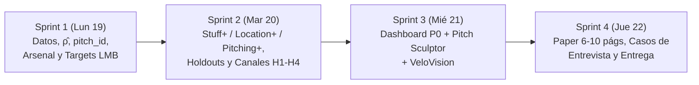

# Plan de Implementación y Sprints — Diablos AeroVision

> **Fecha de inicio del plan:** Lunes 19 de octubre de 2026  
> **Entrega final:** Jueves 22 de octubre de 2026, 23:59 CDMX (`itamsportsanalytics@gmail.com`)  
> **Regla de oro:** El núcleo obligatorio (P0: datos, modelos, validaciones, delta de altitud y simulador base) siempre tiene prioridad sobre los diferenciadores (P1: Pitch Sculptor y VeloVision) y extras (P2).

---

## Mapa General de Sprints

---

## Sprint 1: Fundación de Datos, Física ($\hat{\rho}$), Identidad Invariante y Targets LMB (P0)
**Objetivo:** Tener el dataset limpio, sin *data leakage*, con densidad continua por juego, identidad de pitcheo inmune al reetiquetado de TrackMan, ambos túneles y el `xRunValue` calibrado 100 % con datos de la LMB.

| ID | Tarea | Prio | Archivos / Rutas | Criterio de Aceptación y Verificación |
| :--- | :--- | :---: | :--- | :--- |
| **T1.1** | **Entorno, carga segura y limpieza base** | P0 | `src/config.py` `src/io.py` `src/schema.py` | `pyarrow >= 20` instalado. `EffectiveVelo` numérico; `altitude_category` imputada por moda de `game_anon_id`; mano del pitcher imputada por moda/signo de `RelSide`; filtro de anomalías de radar (`65 <= RelSpeed <= 105`). |
| **T1.2** | **Densidad del aire continua ($\hat{\rho}$) por juego** | P0 | `src/physics/density.py` `reports/altitude/game_density.csv` | Estima el índice de arrastre por juego a partir de la desaceleración de rectas (`ay0`, `vy0`, `SpeedDrop`, `RelSpeed`), suavizado por juego y normalizado a `No Altitude = 1.0`. Verifica que `Extreme Altitude` tenga $\hat{\rho}$ significativamente menor (~0.80–0.85). |
| **T1.3** | **Identidad de pitcheo invariante (`pitch_id`)** | P0 | `src/features/identity.py` `reports/altitude/relabeling_audit.csv` | Cuantifica el reetiquetado de `AutoPitchType` entre altitudes para los mismos pitchers y agrupa cada `(pitcher_anon_id, year)` usando solo variables en el punto de soltura (`RelSpeed`, `SpinRate`, `SpinAxis` cíclico, `RelHeight`, `RelSide`), asignando la etiqueta mayoritaria a nivel del mar. |
| **T1.4** | **Features relacionales de arsenal, secuencia y ambos túneles** | P0 | `src/features/arsenal.py` | Calcula recta primaria por pitcher-año (definida en nivel del mar), `velo_diff_vs_fb`, `ivb_diff_vs_fb`, `hb_diff_vs_fb`, `pitch_usage_pct`, `prev_pitch_type` (verificando orden dentro de cada PA) y **ambas versiones** de `tunnel_similarity`: (a) distancia de release point (bases) y (b) distancia 3D a 170 ms con polinomios `PitchTrajectory*`. |
| **T1.5** | **Targets multi-objetivo, `xRunValue` LMB y Splits oficiales** | P0 | `src/targets.py` `src/splits.py` `src/baseline.py` | Estima la matriz empírica de expectativa de carreras LMB por estado `Outs × Balls × Strikes` usando `RunsScored` y `OutsOnPlay` (2024–2025). Genera los 8 targets oficiales y define el **Baseline Nulo** (xRV medio por conteo) junto con los 3 splits: *Pitcher GroupKFold*, *Season (24–25 → 26)* y *Park (No+Med → Extreme)*. |

---

## Sprint 2: Submodelos (Stuff+, Location+, Pitching+), Holdouts y Canales de Altitud (P0)
**Objetivo:** Entrenar y validar los tres submodelos en sus sabores **neutral** y **CDMX**, superar el baseline nulo en los 3 holdouts, separar el *canal Stuff* del *canal parque* y demostrar empíricamente H1–H4.

| ID | Tarea | Prio | Archivos / Rutas | Criterio de Aceptación y Verificación |
| :--- | :--- | :---: | :--- | :--- |
| **T2.1** | **Etapa A — Traductor físico de movimiento por densidad** | P0 | `src/models/movement.py` | Modelo con variación intra-pitcher que predice `InducedVertBreak` y `HorzBreak_norm` a partir de `(release, velo, spin, eje, \hat{\rho})`. Permite predecir cuánto movimiento pierde o gana cualquier lanzamiento al pasar de $\hat{\rho}_0 = 1.0$ a $\hat{\rho}_{\text{CDMX}}$. |
| **T2.2** | **Entrenamiento de Stuff+, Location+ y Pitching+ (neutral y entorno)** | P0 | `src/models/stuff.py` `src/models/location.py` `src/models/pitching.py` | Tres modelos LightGBM separados respetando estrictamente las restricciones de columnas (§6 de `PROJECT_CONTEXT.md`). Predicen los 8 targets, los combinan mediante regresión hacia `xRV` y escalan a `100 + 10·z` tomando como referencia la LMB a $\hat{\rho}_0$. |
| **T2.3** | ** Suite de Validación Fuera de Muestra y Estabilidad** | P0 | `analysis/run_validation.py` `reports/validation/metrics_summary.csv` | Tabla de RMSE, Log-Loss y curvas de calibración superando al Baseline Nulo en: (1) *Pitcher Holdout*, (2) *Season Holdout 2026* y (3) *Park Holdout*. Incluye correlación año-a-año (2024 vs 2025) del Stuff+ por pitcher. |
| **T2.4** | **Descomposición Canal Stuff vs. Canal Parque y Prueba de H1–H4** | P0 | `analysis/run_hypotheses.py` `reports/altitude/delta_by_shape.csv` `reports/altitude/channel_decomposition.csv` | Cuantifica con intervalos de confianza el $\Delta\text{Stuff+}$ por pitch shape en los mismos pitchers, separa qué porcentaje del castigo en `Extreme Altitude` proviene del menor quiebre (*canal Stuff*) vs mayor vuelo del batazo (*canal parque*), y genera las tablas/gráficas de **H1, H2, H3 y H4**. |
| **T2.5** | **Exportación del Entregable 1 (Scores por Pitch, Pitcher y Arsenal)** | P0 | `analysis/export_scores.py` `reports/leaderboards/pitcher_arsenal_summary.csv` | Genera el archivo local completo de scores por `PitchUID` (para entrega, ignorado en git) y los agregados limpios ($\le 2\text{ MB}$) por pitcher y repertorio listos para el dashboard. |

---

## Sprint 3: Producto Interactivo — Simulador Base (P0), Pitch Sculptor (P1) y VeloVision (P1)
**Objetivo:** Construir la herramienta para el pitching coach y director deportivo cumpliendo primero los 3 requisitos obligatorios de las bases y sumando nuestros dos módulos diferenciadores.

| ID | Tarea | Prio | Archivos / Rutas | Criterio de Aceptación y Verificación |
| :--- | :--- | :---: | :--- | :--- |
| **T3.1** | **Dashboard Simulador Obligatorio (Núcleo UI)** | P0 | `dashboard/app.py` `dashboard/components/` | App en español (tema rojo Diablos + negro) que corre sin datos crudos: (1) Entrada manual de pitch y cálculo en vivo de Stuff+, (2) Comparación lado a lado Harp Helú vs Nivel del Mar con pérdida de quiebre, (3) Mapa de movimiento de pitcheos más/menos efectivos y (4) Leaderboard + SHAP por pitcher. |
| **T3.2** | **Motor AI Pitch Sculptor (Optimización con Factibilidad)** | P1 | `src/sculptor/optimizer.py` `dashboard/pages/sculptor.py` | Dado un pitcheo o arsenal, busca en el vecindario real de pitchers con el mismo arm slot ($\pm 5^\circ$) y velocidad ($\pm 1.5\text{ mph}$) qué modificación de forma o mezcla de repertorio maximiza `Stuff+ CDMX`. Muestra los pitchers comparables reales de la LMB y la nota cualitativa de coaching. |
| **T3.3** | **Módulo VeloVision (Video $\to$ Arm Slot $\to$ Rango Stuff+ CDMX)** | P1 | `src/vision/pose_slot.py` `dashboard/pages/velovision.py` | Procesa un clip `.mp4` con MediaPipe Pose, detecta el frame de soltura, calcula el ángulo de brazo y release relativo, y devuelve el **rango intercuartílico (P25–P75) de Stuff+ CDMX** para ese slot (acotable al ingresar velocidad). |
| **T3.4** | **Validación Empírica de VeloVision por Anotación Manual** | P1 | `analysis/validate_vision.py` `reports/validation/vision_mae.csv` | Evalúa el error absoluto medio (MAE en grados) y acuerdo inter-anotador comparando el arm slot extraído por MediaPipe contra la marcación manual de 2 integrantes del equipo sobre 15–20 frames de prueba. |

---

## Sprint 4: Recomendaciones Operativas, Documento Técnico (6–10 págs) y Entrevista (P1/P2)
**Objetivo:** Traducir los hallazgos técnicos en decisiones de reclutamiento y coucheo para Diablos Rojos, redactar el paper técnico y blindar la entrevista de 10 minutos.

| ID | Tarea | Prio | Archivos / Rutas | Criterio de Aceptación y Verificación |
| :--- | :--- | :---: | :--- | :--- |
| **T4.1** | **Entregables 2 y 3: Perfil Físico Ideal y Playbook de Scouting** | P1 | `docs/PERFIL_Y_RECOMENDACIONES.md` | Define el perfil físico y de arsenal que maximiza `Stuff+` y previene HR en el Harp Helú. Prepara los **3 casos ejecutivos para la entrevista de 10 min**: (a) un pitcher subvaluado en la liga ideal para firmar en CDMX, (b) un perfil "trampa de nivel del mar", y (c) un ajuste de secuencia/repertorio casa vs gira. |
| **T4.2** | **Entregable 5: Documento Técnico (6–10 páginas)** | P1 | `docs/DOCUMENTO_TECNICO.md` | Integra marco teórico físico-sabermétrico, justificación de arquitectura y sustitutos de datos, definición formal de escala `Score+`, resultados de los 3 holdouts vs baseline nulo, descomposición de canales, validación de H1–H4 y fronteras/limitaciones del sistema. |
| **T4.3** | **Extras Tácticos (Solo si P0 y P1 están al 100 %)** | P2 | `src/models/tactical_cf.py` `analysis/team_communities.py` | (a) Reconstrucción de franquicias por comunidades de bateadores (Louvain) para aislar candidatos a local en Harp Helú; (b) Capa táctica de Causal Forest condicionada en conteo y secuencia previa. |
| **T4.4** | **QA Final, Freeze y Empaquetado de Entrega** | P0 | `README.md` `reports/` | Revisión de que ningún número carezca de respaldo en `reports/`, verificación de que no existan datos crudos en git, grabación de video demo de respaldo (Plan B) y armado del paquete para `itamsportsanalytics@gmail.com`. |
