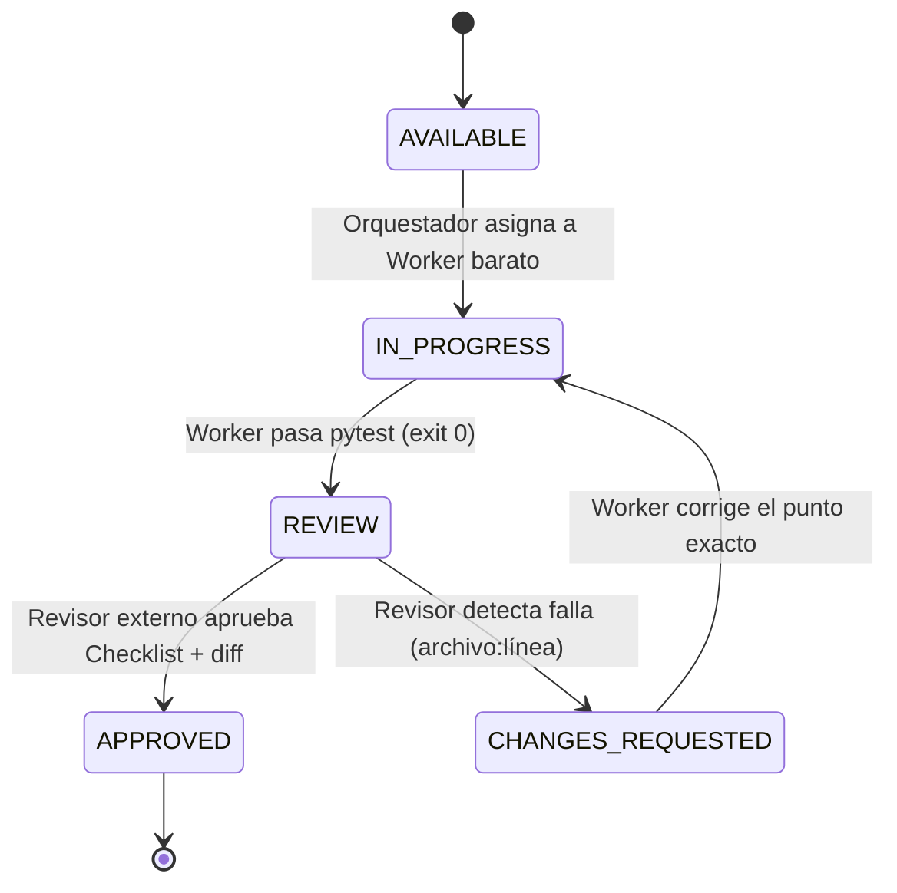
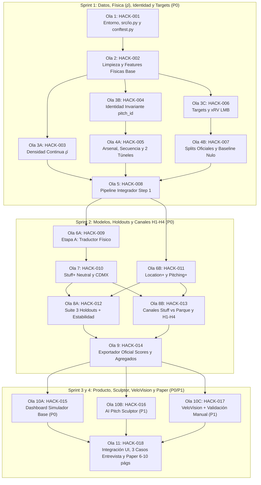

# Plan de Implementación y Protocolo Multi-Agente — Diablos AeroVision

> **Estado a la fecha (22-oct-2026):** el plan original tenía 18 tareas (HACK-001 a 018) en 8 olas. El tablero real tiene **21** (se agregaron HACK-019 rediseño visual, HACK-020 despliegue y HACK-021 homepage). Estados: las 21 tareas `APPROVED` (HACK-017 y HACK-020 cerradas el 22-oct-2026). La fuente de verdad de los estados es [`TASKS.md`](TASKS.md).
>
> **Nota de proceso:** el flujo real fue Orquestador → Worker → Revisor como se describe abajo, pero con **reaperturas**: HACK-010 se reabrió dos veces (Stuff+ pasó a entrenarse como residuo sobre el conteo; luego se quitaron los proxies de ubicación y se regularizó con CV por pitcher), HACK-012 cambió de criterio (Pitching+ gana en todo; Stuff+ se juzga en `xrv_pitcher` con tolerancia de empate 1e-4 y en targets de stuff), HACK-013 pasó a una descomposición de 3 términos, y HACK-018 se rehízo en LaTeX con Stuff+ reencuadrado como descriptor físico. HACK-017 17-D es un piloto con n=4 **sin revisión independiente**, por decisión del usuario. Los textos de abajo conservan el plan original; donde difieren, manda `TASKS.md`.

> **Entrega final:** Jueves 22 de octubre de 2026, 23:59 CDMX (`itamsportsanalytics@gmail.com`)  
> **Backlog detallado por tarea:** **[`docs/TASKS.md`](TASKS.md)**  
> **Contrato de columnas y firmas:** **[`docs/CONTRACT.md`](CONTRACT.md)**

---

## 1. Protocolo de Trabajo en 3 Roles (Orquestador $\to$ Worker $\to$ Revisor Externo)

### A. Rol 1: Agente Orquestador (`ORCHESTRATOR`)
1. Lee la tabla de estado en [`docs/TASKS.md`](TASKS.md).
2. Selecciona todas las tareas en estado `AVAILABLE` cuyas dependencias (`DependsOn`) estén en `APPROVED`.
3. Puede despachar **múltiples agentes ejecutores en paralelo** dentro de una misma *Ola (Wave)* porque cada tarea tiene su lista estricta de archivos permitidos (`AllowedPaths`) sin colisiones.
4. Prompt estándar que el Orquestador le envía a cada Worker:
   > *"Ejecuta únicamente la tarea `HACK-XXX`. Lee primero `AGENTS.md`, `docs/CONTRACT.md` y la sección `HACK-XXX` en `docs/TASKS.md`. Respeta estrictamente `AllowedPaths`, implementa el código y su test unitario, corre el comando `Verify` hasta obtener `exit code 0`, cambia el estado de `HACK-XXX` a `REVIEW` en `docs/TASKS.md` y entrega el output real de consola."*

### B. Rol 2: Agente Ejecutor / Coder (`WORKER` — Modelo Rápido/Económico)
1. **Alcance cerrado:** Solo puede crear o modificar los archivos listados en `AllowedPaths` de su tarea.
2. **Cero adivinanzas:** Usa los nombres exactos de columnas y funciones de [`docs/CONTRACT.md`](CONTRACT.md).
3. **Pruebas obligatorias:** Toda tarea incluye su archivo `tests/test_*.py` que corre en `< 5 s` usando el fixture sintético `synthetic_lmb_df`.
4. **Prohibido dar por terminada la tarea** si el comando `Verify` no devuelve `0`.

### C. Rol 3: Agente Revisor Independiente (`REVIEWER` — Otra Empresa/Modelo)
1. Toma cualquier tarea en estado `REVIEW`.
2. Ejecuta tres verificaciones objetivas:
   - `git status` / `git diff`: ¿El Worker solo tocó archivos dentro de `AllowedPaths`?
   - Ejecuta él mismo el comando `Verify` en terminal: ¿Pasa al 100 %?
   - Revisa punto por punto el **`Reviewer Checklist`** de esa tarea en [`docs/TASKS.md`](TASKS.md) (cero *data leakage*, cero uso de `AutoPitchType` para comparar altitudes, cero números inventados).
3. Prompt estándar para el Agente Revisor:
   > *"Actúa como Revisor Independiente de la tarea `HACK-XXX`. Lee `AGENTS.md`, `docs/CONTRACT.md` y la especificación de `HACK-XXX` en `docs/TASKS.md`. Revisa el código modificado, ejecuta el comando `Verify` y evalúa cada casilla del `Reviewer Checklist`. Si todo cumple sin excepciones, marca `State: APPROVED` en `docs/TASKS.md`. Si algo falla, marca `State: CHANGES_REQUESTED` indicando `archivo:línea` y la corrección requerida."*

---

## 2. Grafo de Ejecución por Olas Paralelas (Waves)

Gracias a que `AllowedPaths` está particionado, el Orquestador puede ejecutar las 18 tareas en **8 olas secuenciales**, corriendo en paralelo las tareas de una misma ola:

---

### Estado de las olas (a la fecha)
| Ola | Tareas | Estado |
| :--- | :--- | :--- |
| 1–5 (Sprint 1) | HACK-001 a 008 | `APPROVED` |
| 6–9 (Sprint 2) | HACK-009 a 014 | `APPROVED` (HACK-010 reabierta dos veces; HACK-012 con criterio actualizado; HACK-013 de 3 términos) |
| 10 | HACK-015 y 016 | `APPROVED` |
| 10 | HACK-017 VeloVision | `APPROVED` (17-A/B/C y ajustes por video real aprobados; 17-D piloto n=4 sin revisión independiente) |
| 11 | HACK-018 (LaTeX) | `APPROVED` (sección de VeloVision actualizada con el piloto) |
| Extra | HACK-019 modo claro, HACK-021 homepage | `APPROVED` |
| Extra | HACK-020 despliegue | `APPROVED` (app publicada en https://diablos-aerovision.streamlit.app; ver [`DEPLOY.md`](DEPLOY.md)) |

## 3. Resumen de Sprints

| Sprint | Olas | Tareas | Entregable de Salida del Sprint |
| :--- | :---: | :--- | :--- |
| **Sprint 1 (Lun 19)** | Olas 1–5 | `HACK-001` a `HACK-008` | `data/stuff_processed_df.parquet`, $\hat{\rho}$ por juego, `pitch_id` invariante, ambos túneles, `xrv_pitcher` LMB y splits listos. |
| **Sprint 2 (Mar 20)** | Olas 6–9 | `HACK-009` a `HACK-014` | Modelos `Stuff+`, `Location+`, `Pitching+` (neutral y CDMX), tablas de los 3 holdouts superando al baseline nulo, descomposición de canales, H1–H4 y Entregable 1 exportado. |
| **Sprint 3 (Mié 21)** | Ola 10 | `HACK-015` a `HACK-017` | Dashboard Simulador Obligatorio (`P0`) + motor prescriptivo **Pitch Sculptor** (`P1`) + **VeloVision** validado (`P1`). |
| **Sprint 4 (Jue 22)** | Ola 11 | `HACK-018` | Perfil Físico Ideal, 3 casos para la entrevista de 10 min, Documento Técnico de 6–10 páginas y paquete final de entrega. |
